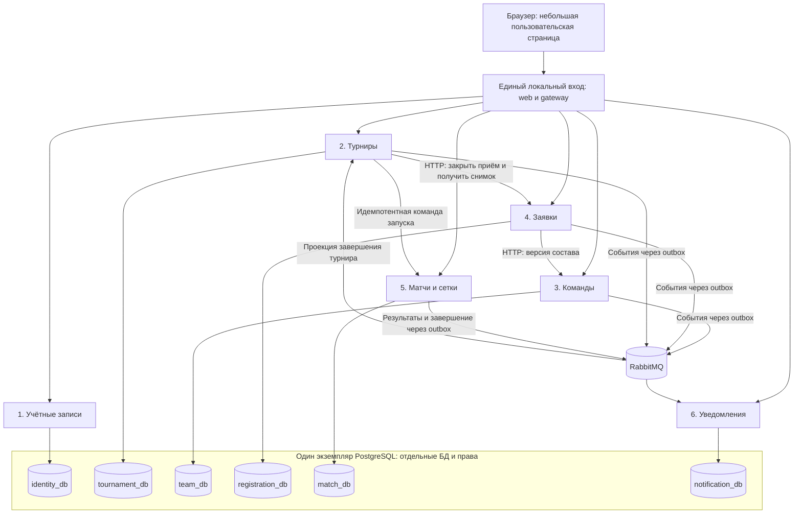

# OpenTournament: предлагаемая архитектура

Статус: проект к ТЗ 0.1; границы и стек ожидают согласования P5. В схеме ровно шесть бизнес-сервисов; web, gateway, PostgreSQL и RabbitMQ в это число не входят.

Сплошная стрелка с HTTP означает запрос, результат которого нужен для конкретной операции. RabbitMQ передаёт сохранённые факты для последующей обработки; получатель может обработать их позже и получить повтор. Круглая форма БД не означает отдельный сервер для каждого сервиса.

## Где находится истина

| Вопрос | Владелец данных |
| --- | --- |
| Кто вошёл и действительно ли подписан токен? | Учётные записи; подпись проверяют локально по открытому ключу |
| Кто владеет турниром и какой опубликован регламент? | Турниры |
| Кто сейчас состоит в команде? | Команды |
| Кто принят, сколько занято мест и какой состав зафиксирован на турнир? | Заявки |
| Кто победил, куда переходит и кто чемпион? | Матчи и сетки |
| Какие сообщения адресованы пользователю и что он прочитал? | Уведомления |

Снимок состава в заявке — исторический факт, а не вторая редактируемая команда. Публичное завершение турнира — проекция подтверждённого итога сервиса матчей, а не второй алгоритм определения чемпиона.

## Что проверяем до реализации всех функций

После принятия стека: маленький HTTP-сервис читает/пишет свою PostgreSQL-БД; публикуется и обрабатывается одно сообщение RabbitMQ; проверяется повтор сообщения; компоненты запускаются вместе и отдельно. Это проверка выбранных инструментов, не основание заранее объявить готовыми все бизнес-функции.

Исходный код не создаётся до согласования ТЗ. Фактически выполненные проверки окружения ограничены Python HTTP, SQLite в памяти и тестовым Linux-контейнером; полный стек ещё не проверен.
