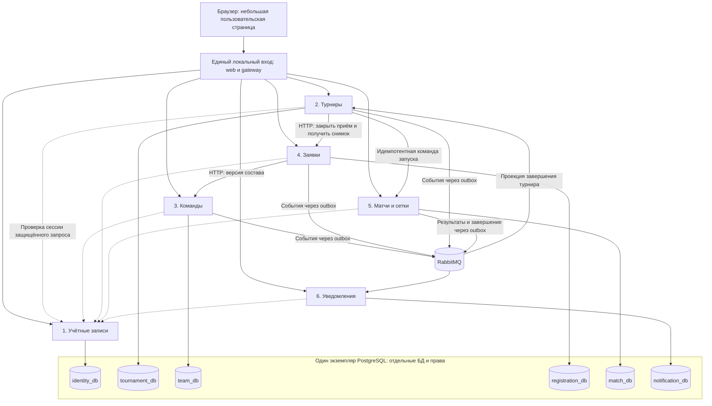

# OpenTournament: предлагаемая архитектура

Статус: схема к ТЗ 0.3. Backend-стек принят; серверная сессия предложена для принятого UX сохранения входа, frontend уточняется. В схеме ровно шесть бизнес-сервисов; web, gateway, PostgreSQL и RabbitMQ в это число не входят.

Сплошная стрелка с HTTP означает запрос, результат которого нужен для конкретной операции. RabbitMQ передаёт сохранённые факты для последующей обработки; получатель может обработать их позже и получить повтор. Круглая форма БД не означает отдельный сервер для каждого сервиса.

## Где находится истина

| Вопрос | Владелец данных |
| --- | --- |
| Кто вошёл и действует ли его сессия? | Учётные записи; защищённые бизнес-запросы обращаются к закрытому API проверки, чужие таблицы не читают |
| Кто владеет турниром и какой опубликован регламент? | Турниры |
| Кто сейчас состоит в команде? | Команды |
| Кто принят, сколько занято мест и какой состав зафиксирован на турнир? | Заявки |
| Кто победил, куда переходит и кто чемпион? | Матчи и сетки |
| Какие сообщения адресованы пользователю и что он прочитал? | Уведомления |

Снимок состава в заявке — исторический факт, а не вторая редактируемая команда. Публичное завершение турнира — проекция подтверждённого итога сервиса матчей, а не второй алгоритм определения чемпиона.

Проверка сессии — отдельная синхронная зависимость от identity. При его недоступности защищённые действия отвечают 503; публичные чтения могут работать. Это цена простого серверного отзыва и не означает, что остальные сервисы обращаются к таблицам учётных записей. Выход не отменяет уже разрешённые фоновые задания. Сравнение с offline JWT и точный контракт — ADR-0005 и session-design-research.md.

## Что проверяем до реализации всех функций

Стек принят. Следующая техническая проверка после согласования ТЗ: маленький HTTP-сервис читает/пишет свою PostgreSQL-БД; публикуется и обрабатывается одно сообщение RabbitMQ; проверяется повтор сообщения; компоненты запускаются вместе и отдельно. Это проверка выбранных инструментов, не основание заранее объявить готовыми все бизнес-функции.

Исходный код не создаётся до согласования ТЗ. Фактически выполненные проверки окружения ограничены Python HTTP, SQLite в памяти и тестовым Linux-контейнером; полный стек ещё не проверен.
